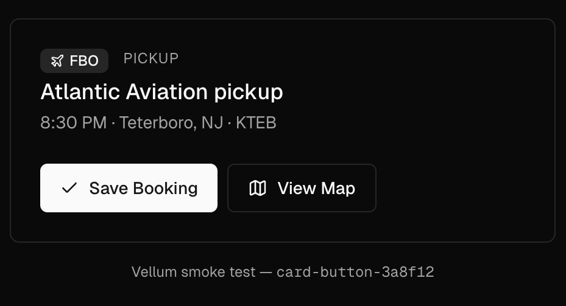

# Vellum

> Local design iteration for Claude Code. A self-hosted alternative to SuperDesign that generates static HTML/CSS mockups using your codebase's real design tokens and component vocabulary: Tailwind + shadcn/ui, Quasar + Vue, or a generic fallback for any other stack.

No paid service. No account. No remote API. Files live in `.claude/designs/` inside your repo.



Above: a Vellum-generated draft for [PathSync](https://github.com/applesnort/) — neutral baseColor in dark mode, real shadcn Button class strings, real CSS-variable tokens. No React, no build step — just an `.html` file you can open in any browser.

## Why

SuperDesign is great, but it's a paid service that runs your design iterations on a remote canvas. Vellum does the same workflow — branch, replace, iterate — but stays entirely local and reads your project's actual design tokens, `tailwind.config.ts`, and shadcn/ui components so generated drafts match your real app at ~95% fidelity.

You stay in your editor. Drafts are git-trackable. Tokens never leave your machine.

## Install

```
/plugin marketplace add applesnort/vellum
/plugin install vellum@applesnort
```

## First-time setup

From any frontend project root:

```
/vellum init
```

`init` detects the stack profile (`tailwind-shadcn`, `tailwind-only`, `quasar-vue`, or `generic`), extracts tokens and component class vocabulary the way that stack expresses them, and writes `.claude/designs/_context/` (context.md, tokens.css, head.html, per-component vocabularies). Re-run any time tokens or the stack change.

## Workflow

```
/vellum create modal-redesign
/vellum draft modal-redesign --title "Baseline" -p "Reproduce the current trip booking modal at 1100px wide, dark theme, all sections visible."
/vellum open <draft-id>

# branch into 4 variants
/vellum iterate <draft-id> --mode branch -p "Linear command-bar header" -p "Editorial magazine" -p "Stripe-dense" -p "Terminal/Vercel"

# refine the winner in place
/vellum iterate <chosen-draft-id> --mode replace -p "Tighten field widths via 12-col grid; cap email at max-w-sm; group passenger contact in one row."
```

Drafts are self-contained `.html` files that load your stack's CSS via CDN and inline your project tokens. Open in any browser — no dev server needed.

## Layout lint

After every `draft` and `iterate`, Vellum runs `lint.mjs`. It renders the draft in Chromium at 1440px and 390px and measures the DOM for composition defects: horizontal scroll, stacked headings, section gaps that are not larger than field gaps, bordered boxes closer than 8px, too much helper text, and misaligned columns. FAIL findings are fixed before the draft is shown.

The lint uses the `playwright` package from the repo you run it in. If the repo does not have it: `npm install --save-dev playwright && npx playwright install chromium`.

## Verbs

| Verb | Purpose |
|---|---|
| `init` | One-time per repo. Extracts tokens + shadcn class vocabulary into `.claude/designs/_context/`. |
| `create <name>` | New project folder under `.claude/designs/<slug>/`. |
| `draft <project> --title "X" -p "..."` | Generate a baseline draft from a prompt. |
| `iterate <draft-id> --mode replace -p "..."` | Refine in place. Updates same file. |
| `iterate <draft-id> --mode branch -p "..." -p "..."` | Spawn N sibling drafts from one parent. Each records its `hypothesis`, what it `favors`, and what it `sacrifices`. |
| `critique <draft-id> [--no-blind] [--task "..."]` | Expert inspection: at most five ranked findings, each tied to a principle and to evidence. |
| `open <draft-id>` | Open the HTML in your default browser. |
| `list [project]` | Show project tree of drafts. |

## Critique

`/vellum critique <draft-id>` inspects a draft the way a usability expert would, and writes `critiques/<draft-id>.md`:

1. It writes a six-line `brief.md` for the project (user, primary task, decisions, data conditions, viewports, pain points), inferred from the draft and its prompts. It asks only if it cannot infer the primary task.
2. It runs the layout lint with screenshots at the brief's viewports.
3. **Blind step:** before it shows anything, it asks for *your* top 3 problems. At the end it compares your list with its own: both found, critique only, you only. Skip this with `--no-blind`. It is the part that trains your eye.
4. It runs a heuristic evaluation and a cognitive walkthrough of the primary task, and reports at most five findings. Each finding names the element, the problem and the task it hurts, the principle (tagged `standard`, `empirical`, `practitioner` or `hypothesis`), a concrete fix, and its evidence: `observed` (a lint rule or screenshot shows it), `inferred`, or `needs users`.

The principles and their sources are in `skills/vellum/CRITIQUE.md`. The critique is expert inspection: it produces hypotheses, not user evidence. Findings tagged `needs users` become the questions for a first-click or task test.

Branch from the critique, so each alternative tests a different fix:

```
/vellum critique baseline-3f1c0a
/vellum iterate baseline-3f1c0a --mode branch -p "Triage queue grouped by severity" -p "Six-column table with a detail rail"
```

See [`examples/311-dispatch/`](./examples/311-dispatch/) for a full run on real NYC 311 data.

## What Vellum is NOT (yet)

- **Not a real-component renderer.** Drafts are static HTML that mimics your shadcn classes — they won't show interactive Switch state or animated Tabs transitions. Hardcoded data-state classes work for static visual mocks (the same approach SuperDesign uses).
- **Not a Storybook replacement.** If you need real React components rendered with Vitest interactions, Storybook is still the answer. A `promote <draft-id>` verb that converts HTML → JSX with shadcn imports is on the roadmap.
- **Not a multi-page flow generator.** One draft = one page. SuperDesign's `execute-flow-pages` equivalent is roadmap.

## How it works

Vellum is a Claude Code skill — a markdown file (`SKILL.md`) that instructs the Claude model what to do when invoked. It doesn't run as a daemon or background process; it executes inside your Claude Code session.

When you run `/vellum draft …`, Claude:

1. Reads `.claude/designs/_context/context.md` for your project's design vocabulary
2. Reads `HTML_TEMPLATE.html` for the boilerplate scaffold (Tailwind CDN, font wiring, token injection)
3. Generates body markup using only the shadcn class strings extracted from your real components
4. Writes a self-contained `.html` file you can open immediately

The intelligence is in the **`init` extraction**: it grabs your `:root` and `.dark` CSS variable blocks verbatim, your `theme.extend.colors` mapping, and the canonical className strings from each shadcn primitive. Subsequent iterations reference this context instead of re-reading the codebase, so prompts stay tight and drafts stay consistent.

## Roadmap

- [ ] `promote <draft-id>` — convert locked HTML draft into a React component file with proper shadcn imports and `cn()` usage
- [ ] `decide <project>` — compare sibling drafts against the brief and write a decision record
- [ ] `serve` — local HTTP gallery for flipping through drafts side-by-side
- [ ] Multi-page flows
- [ ] Storybook story export
- [ ] Per-project `.vellumrc` to override extraction paths for non-standard repo layouts

## Philosophy

The name comes from drafting paper architects use — translucent, you sketch over the base drawing without committing. Vellum drafts over your real codebase. Tokens, fonts, components, conventions — all anchored to what's actually there. The sketch is always grounded.

## License

MIT — see [LICENSE](./LICENSE).

## Credits

Inspired by [SuperDesign](https://app.superdesign.dev/), which set the bar for design-iteration agents. Vellum is the local, self-hosted variant for teams who want their iteration loop offline and in-repo.
